# Before / After Review

## Matched Index view — 1440×900

| Before | After |
|---|---|
| 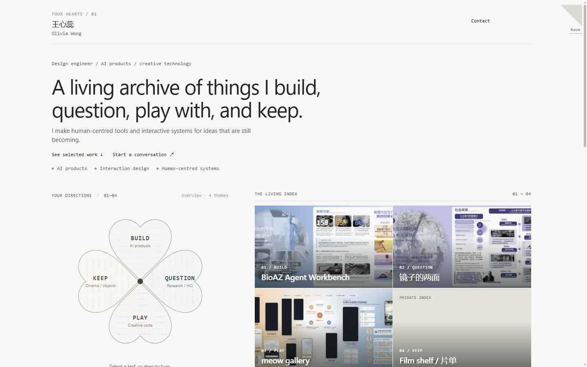 | 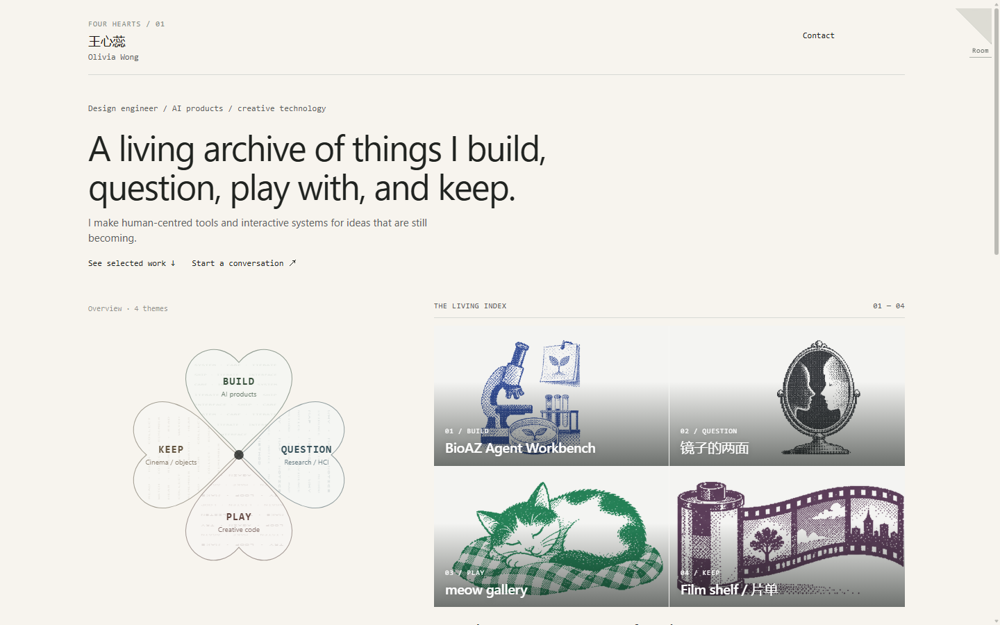 |

**Changed:** unrelated old portfolio screenshots are replaced by subject-matched monochrome illustrations; the missing Film shelf visual is supplied; repeated professional-direction facts and redundant wheel instructions are removed. The four-leaf geometry and muted palette remain.

## Project detail — opened from Selected Works

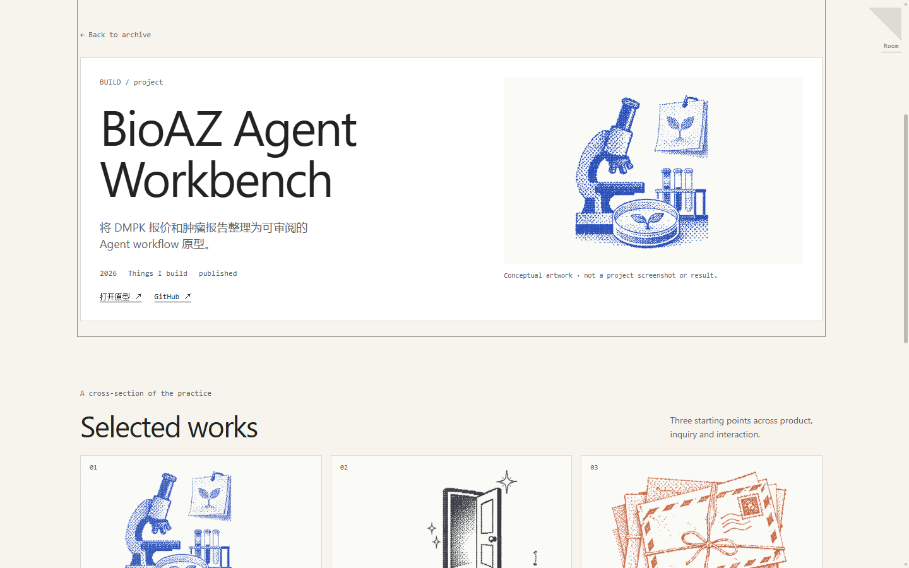

This frame shows the detail in the viewport, correct image proportion, visible provenance, real project links and the return path. The browser report captures the return position and focus: source `scrollTop` was 886 and returned at 886; the source BioAZ card regained focus.

## Direct project URL after refresh

## Room and mobile

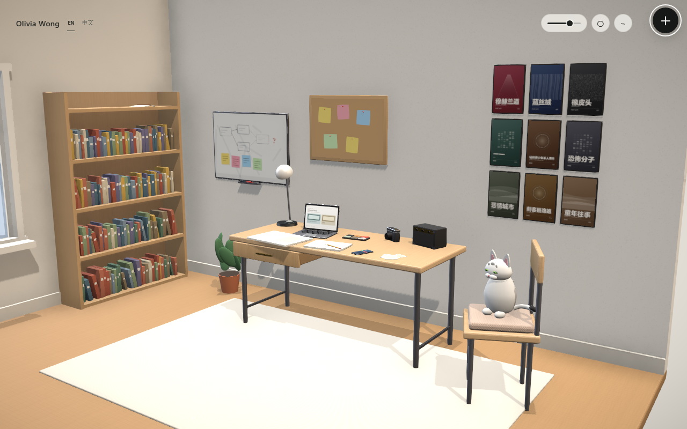

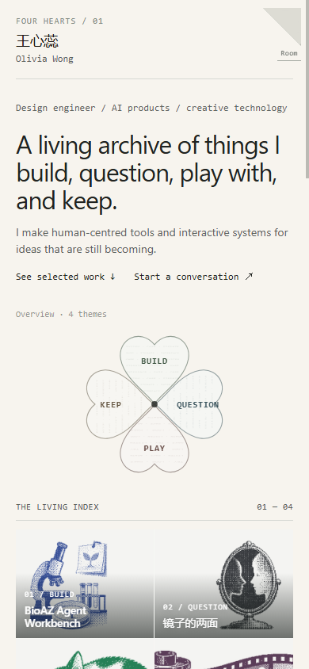

## Motion evidence

Settled screenshots and browser interaction reports are retained. The pointer-cancel test records start/end rotation in `navigation-report.json`; there is no recorded video or full frame-by-frame series.

## Project return preserves reading context — 1440×900, Edge

| Before opening BioAZ | After project Back |
|---|---|
| 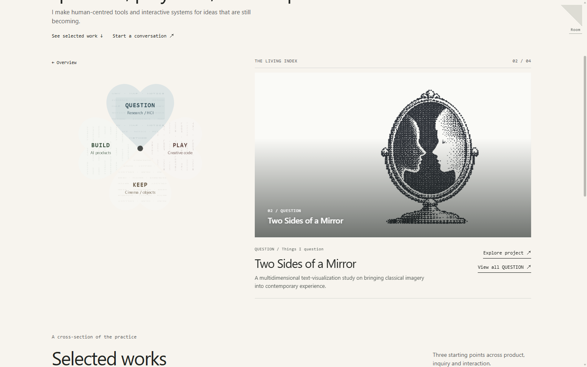 |  |

The matched frames show the same QUESTION artwork and expanded theme before opening a BUILD project and after returning. Before the fix, the Edge report reproduced a reset to BUILD; [the stress report](evidence/design-stress/design-stress-report.json) verifies the corrected return. The selected theme and focused mode now live in the matching history entry, while the project's history entry keeps its source route.

## UX revisit — same local build and browser conditions

| State | Evidence |
|---|---|
| Index, English, 1440×900 | 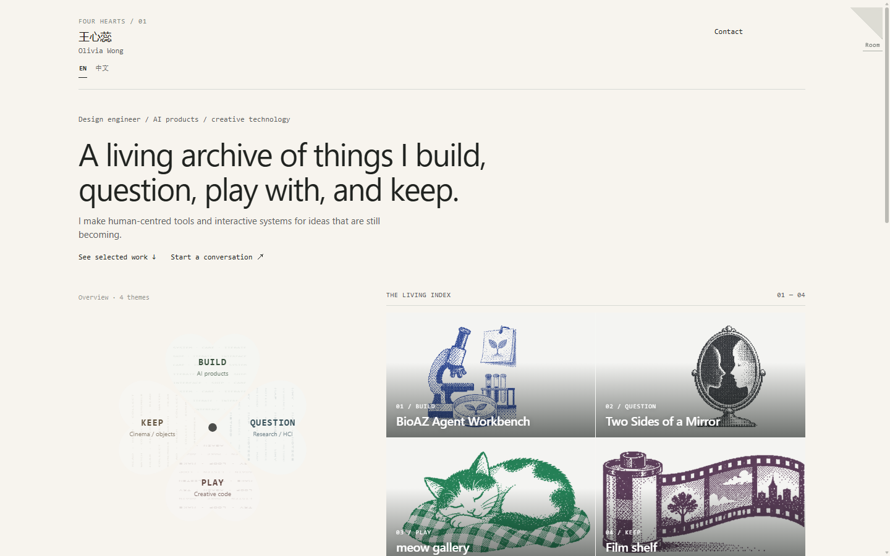 |
| Index, Chinese, 1440×900 | 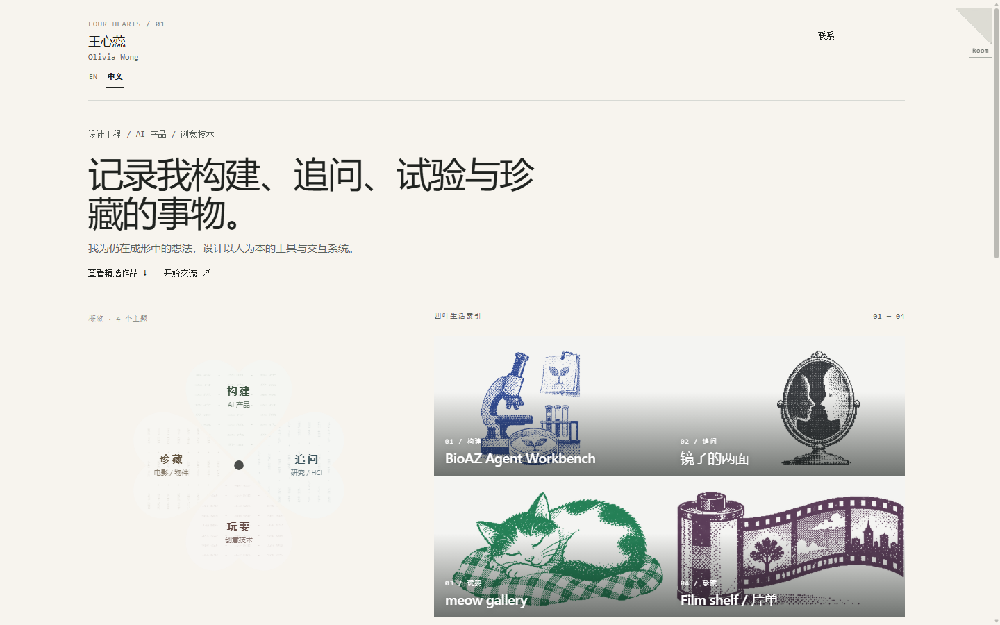 |
| Theme focus and project detail, Chinese | 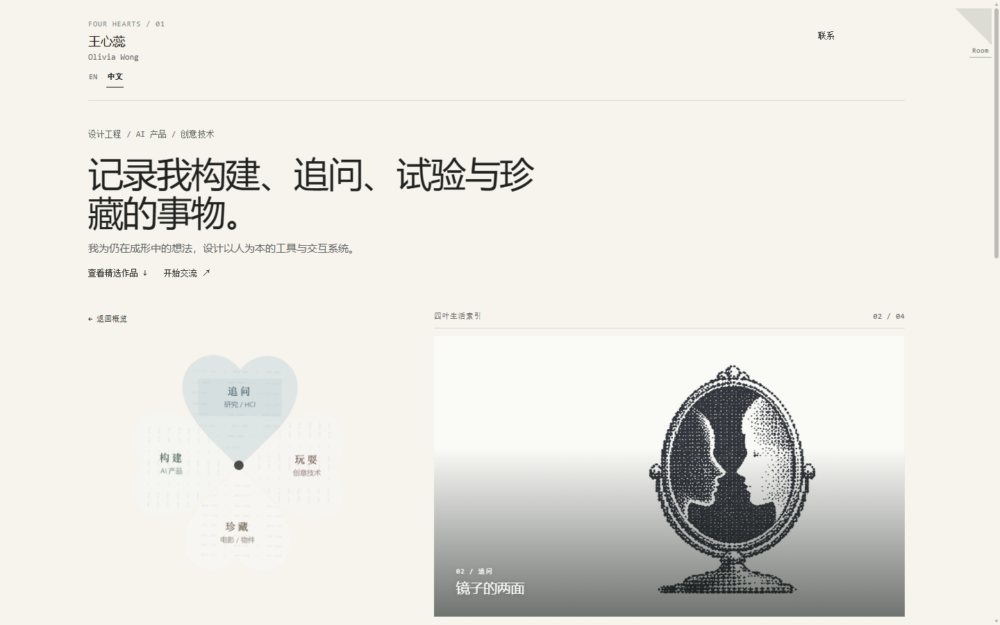 · 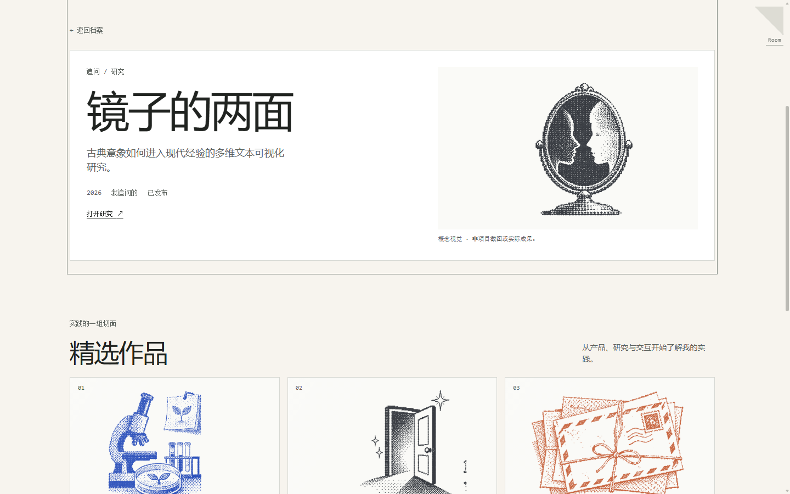 |
| Room reveal mid-transition | 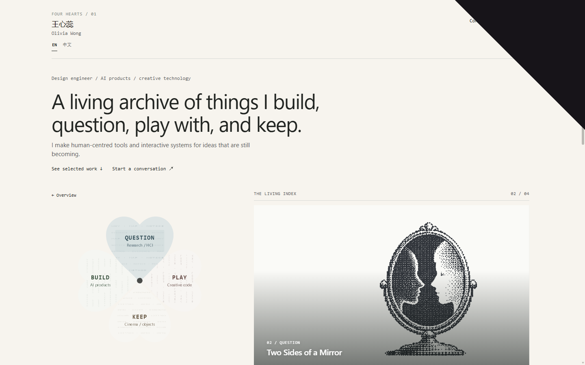 |
| Room hotspot panel, Chinese night palette | 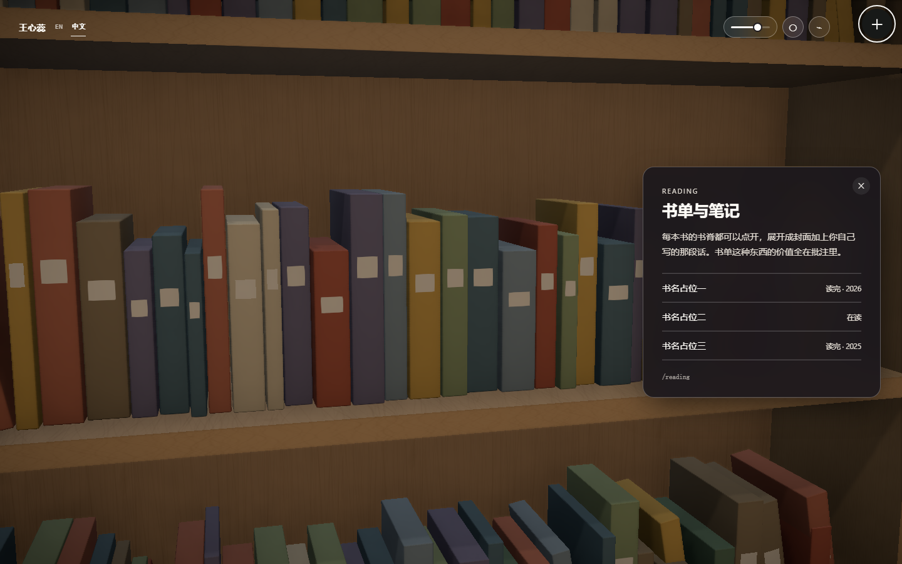 |
| Index, mobile 390×844 | 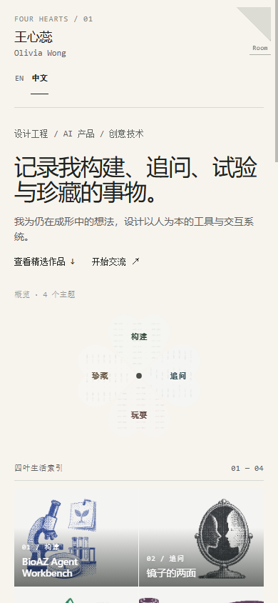 |

The fold now reveals through one clipped surface; the corner control is absent during the transition. Four leaves have no idle stroke. The bilingual toggle persists between Index and Room. The mobile screenshot shows the language controls clear of the fold, with 44px minimum height. [Rehearsal results](evidence/ux-revisit/rehearsal-report.json) record 10 passing checks.
